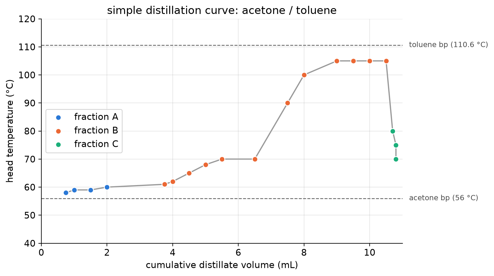
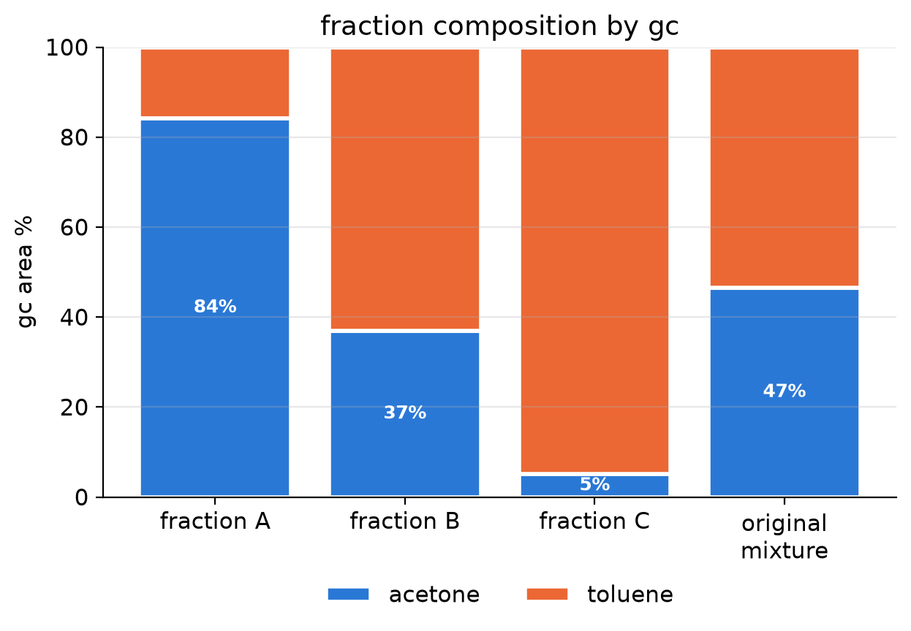
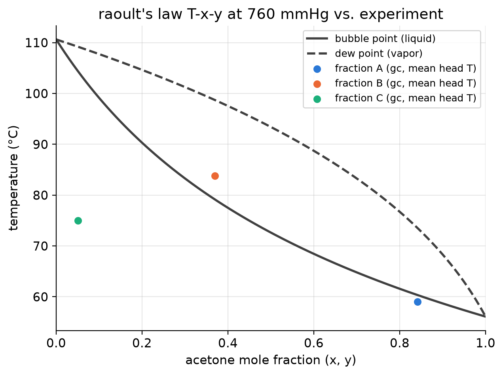
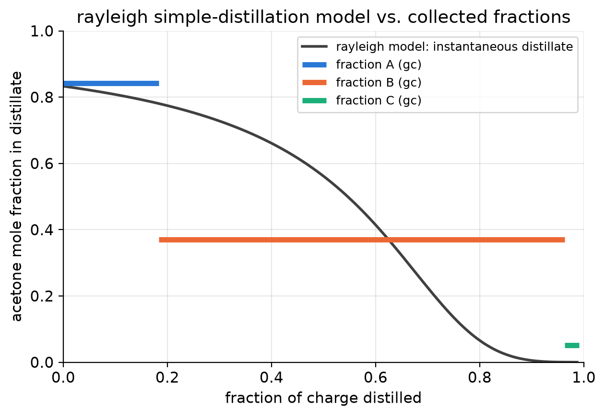

# distillation + gc analysis

simple distillation of an acetone/toluene mixture, analyzed by gas chromatography
and compared against an ideal vle model. experiments performed in a ut austin lab.

## results
- recombined fraction composition: 44.8% acetone vs. 46.6% measured (−1.8 pts)
- volume recovery: 99.1%
- setup behaved as ~1 equilibrium stage (rayleigh model within ~4 pts for fractions a and b)

## methods
- antoine equation + raoult's law → bubble/dew curves, solved with `scipy.optimize.brentq`
- rayleigh equation integrated numerically for batch simple distillation

## assumptions
- gc area % ≈ mole fraction (no detector response factors applied)
- volume fraction distilled ≈ mole fraction distilled
- p = 760 mmhg (austin is ~745 mmhg, which shifts bps < 1 °C)
- ideal liquid (raoult's law)
